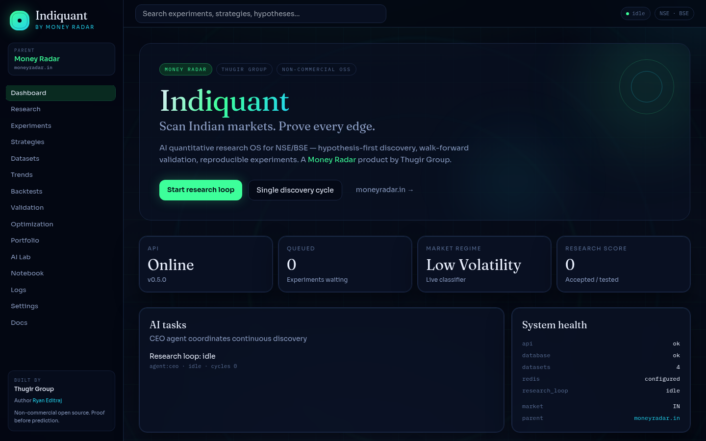
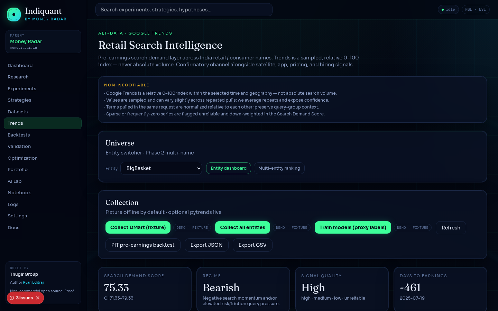
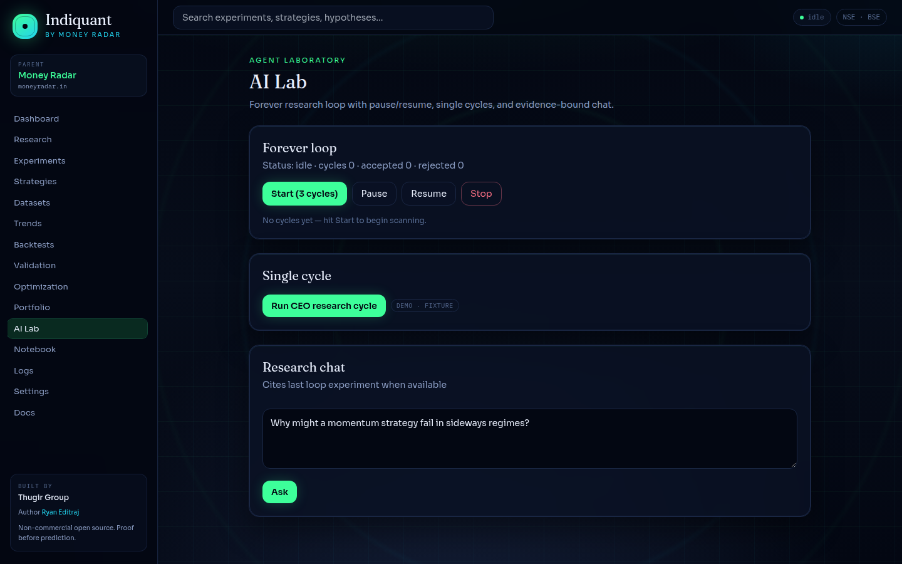
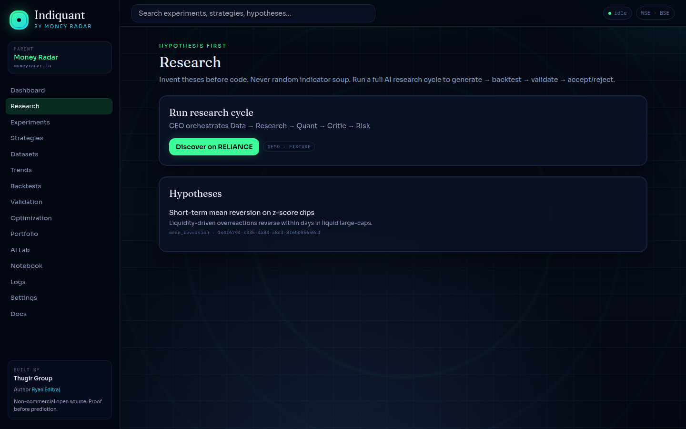

<p align="center">
  
</p>

<h1 align="center">Indiquant</h1>

<p align="center">
  <strong>Prove an Indian-market edge before you trust it.</strong>
</p>

<p align="center">
  Open-source AI quant research OS for NSE and BSE — hypotheses, walk-forward backtests, and Google Trends search-demand scores.
</p>

<p align="center">
  A <a href="https://moneyradar.in"><strong>Money Radar</strong></a> product by <strong>Thugir Group</strong><br/>
  Maintained by <a href="https://github.com/ryaneditraj"><strong>Ryan Editraj</strong></a>
</p>

<p align="center">
  <a href="https://github.com/ryaneditraj/indiquant/actions/workflows/ci.yml"></a>
  <a href="LICENSE"></a>
  <a href="apps/web/package.json"></a>
  <a href="apps/api/pyproject.toml"></a>
</p>

<p align="center">
  
  
  
  
</p>

<p align="center">
  <a href="#demo">Demo</a> ·
  <a href="#features">Features</a> ·
  <a href="#quick-start">Quick start</a> ·
  <a href="#usage">Usage</a> ·
  <a href="#project-structure">Structure</a> ·
  <a href="#roadmap">Roadmap</a> ·
  <a href="#faq">FAQ</a> ·
  <a href="#contributing">Contributing</a>
</p>

---

Most “AI trading” tools for the Indian stock market skip the scientific part. They emit a signal, plot one equity curve, and call it research.

Indiquant is the loop those tools leave out: **propose a hypothesis → backtest it → walk-forward validate it → accept or reject it with an experiment ID**. Google Trends search demand sits beside price data as alternative data, always as a relative 0–100 index.

Indiquant is a research lab. It does not place live broker orders.

## Demo

Screenshots below are from a local fixture demo (`make demo`). No broker keys and no live Google Trends pull.

<p align="center">
  
</p>

<p align="center">
  
</p>

<p align="center">
  
</p>

<p align="center">
  
</p>

The social card at `apps/web/public/og.png` is a designed Open Graph image, separate from these UI captures.

## Features

- **Hypothesis-first research loop** — pause, resume, and stop cycles that propose, test, and cite experiment IDs
- **Validation suite** — walk-forward, Monte Carlo, out-of-sample, and lookahead / leakage guards
- **Google Trends intelligence** — multi-entity Search Demand Score for Indian retail names (relative index, never absolute volume)
- **Indian market defaults** — NSE and BSE providers, Asia/Kolkata, INR backtest assumptions
- **Evidence store** — hypotheses, strategies, experiments, and an append-only audit log
- **Analytics plane** — Parquet OHLCV plus DuckDB `SELECT` queries over registered views
- **Radar dashboard** — dark research cockpit, equity charts, Trends ranking, live loop status
- **Offline demo** — fixture bars and fixture Trends so the star path runs without API keys
- **Config, not hardcoding** — `config.yaml` for defaults, `.env` for secrets

## Tech stack

| Layer | Choice |
|-------|--------|
| Dashboard | Next.js 15, React 19, Tailwind CSS |
| API | FastAPI, Python 3.12, Pydantic, SQLAlchemy |
| Research data | Parquet, DuckDB, optional Postgres |
| Jobs | Optional Redis and Celery Beat for weekly Trends pulls |
| AI | OpenAI-compatible chat, with an offline fallback |
| Markets | NSE / BSE adapters, fixture and local CSV providers |

Interactive API docs: `http://localhost:8000/docs` after `make api-dev`.

## Quick start

**Needs:** Python 3.12+, Node.js 20+. No broker keys.

```bash
git clone https://github.com/ryaneditraj/indiquant.git
cd indiquant
cp .env.example .env

make api-install && make web-install
make demo                 # sample OHLCV + Trends fixtures
make api-dev              # terminal 1 — http://localhost:8000/docs
make web-dev              # terminal 2 — http://localhost:3000
```

Open **http://localhost:3000**. Start in **AI Lab** or **/trends**.

`make api-dev` binds to localhost. Docker Compose publishes the API on port 8000 inside the container network.

Docker (Postgres + Redis): `docker compose up`. Full API stack: `docker compose --profile full up`.

`make ci` runs Ruff, pytest, and the web typecheck. The same checks run in [GitHub Actions](.github/workflows/ci.yml).

Set a long random `SECRET_KEY` before any production or staging deploy. Placeholder keys are refused when `QUANT_OS_ENV` is `production` or `staging`.

## Usage

One research cycle without the UI:

```bash
curl -X POST http://localhost:8000/api/v1/ai/cycle \
  -H 'Content-Type: application/json' \
  -d '{"symbol":"RELIANCE","provider":"fixture","persist":true}'
```

Trends score for the fixture universe (relative index):

```bash
curl http://localhost:8000/api/v1/trends/dmart/dashboard?window=90d
```

DuckDB analytics only accepts a single `SELECT` against registered views. File-reading functions such as `read_parquet()` are rejected.

```bash
curl -X POST http://localhost:8000/api/v1/analytics/sync
curl -X POST http://localhost:8000/api/v1/analytics/query \
  -H 'Content-Type: application/json' \
  -d '{"sql":"SELECT count(*) AS n FROM ohlcv_reliance_1d"}'
```

Notebook execution is a local development REPL. It returns 403 when `QUANT_OS_ENV` is production or staging.

Longer notes: [docs/architecture.md](docs/architecture.md) · [docs/trends.md](docs/trends.md) · [examples/research_cycle.md](examples/research_cycle.md).

## Project structure

```
indiquant/
├── apps/api/          FastAPI research OS (backtests, AI loop, Trends)
├── apps/web/          Next.js cockpit (dashboard, Trends, AI Lab)
├── config.yaml        Non-secret defaults (markets, fees, Trends universe)
├── data/sample_csv/   Offline OHLCV samples (RELIANCE, TCS, INFY, NIFTY)
├── docs/              Architecture, Trends, security, screenshots
├── examples/          Worked research-cycle notes
├── scripts/           Smoke and weekly Trends helpers
├── .env.example       Secret names with empty or local-only values
└── docker-compose.yml Postgres + Redis, optional full API profile
```

Flow: **data plugin → bars → signals → backtest → validation → persisted experiment**. The AI loop wraps that with a critic and risk pass. Trends is a parallel intel module.

## Roadmap

Shipped: research CRUD, fixture NSE/BSE adapters, walk-forward validation, the AI research loop, DuckDB analytics, and Google Trends scoring and ranking.

Next: live NSE vendor HTTP, multi-user auth, durable agent checkpoints, and CI that boots the stack with Playwright. Details live in [ROADMAP.md](ROADMAP.md).

## FAQ

### What is Indiquant?

Indiquant is an open-source AI quant research operating system for Indian equity markets (NSE and BSE). You write a hypothesis, backtest it, walk-forward validate it, and keep an experiment ID for the result.

### Is Indiquant a trading bot?

Indiquant is a research lab. It does not place live orders with a broker. A paper broker plugin exists for simulated fills.

### Can I backtest NSE and BSE ideas without a broker API key?

Yes. The default data provider is an offline fixture, and sample CSV files ship in `data/sample_csv`. Live NSE or BSE HTTP adapters stay quiet until `DATA_NSE_API_BASE_URL` or `DATA_BSE_API_BASE_URL` is set.

### What does the Google Trends search-demand score measure?

It is a relative 0–100 search index for configured brand, transactional, category, competitor, and risk queries in India. It is not absolute search volume and it is not a promise of returns.

### How does walk-forward validation work in Indiquant?

The validation suite replays a strategy across rolling train and test windows, then adds out-of-sample, Monte Carlo, and lookahead or leakage checks. A strategy is easier to reject when those checks fail.

### Can I use Indiquant in a commercial product?

Personal research, education, and noncommercial organizations can use it under the [PolyForm Noncommercial License 1.0.0](LICENSE). A paid product, SaaS, or commercial trading desk needs a separate license from [Money Radar](https://moneyradar.in).

### Who maintains Indiquant?

[Ryan Editraj](https://github.com/ryaneditraj) maintains this repository. Indiquant is a Money Radar product built by Thugir Group.

### How do I report a security vulnerability in Indiquant?

Open a private [GitHub security advisory](https://github.com/ryaneditraj/indiquant/security/advisories/new). Do not file a public issue. Policy: [SECURITY.md](SECURITY.md).

## Contributing

See [CONTRIBUTING.md](CONTRIBUTING.md) and [CODE_OF_CONDUCT.md](CODE_OF_CONDUCT.md).

Focused pull requests, fixture-backed tests for Trends and providers, and no secrets in git. Run `make ci` before you push.

## License

**[PolyForm Noncommercial License 1.0.0](LICENSE)**

Personal research, education, and public-interest research are covered. Commercial use (paid products, SaaS, commercial desks) needs a separate license from [Money Radar](https://moneyradar.in).

Required notice: Copyright Thugir Group / Money Radar (moneyradar.in).

## Author

**Ryan Editraj** — AI builder and tech creator (~295K on Instagram).

- GitHub: [github.com/ryaneditraj](https://github.com/ryaneditraj)
- Instagram: [instagram.com/ryaneditraj](https://instagram.com/ryaneditraj)
- Product: [moneyradar.in/indiquant](https://moneyradar.in/indiquant)

Indiquant · Money Radar · Thugir Group

<p align="center">
  <sub>Scan markets. Prove edges. Keep the evidence.</sub>
</p>
